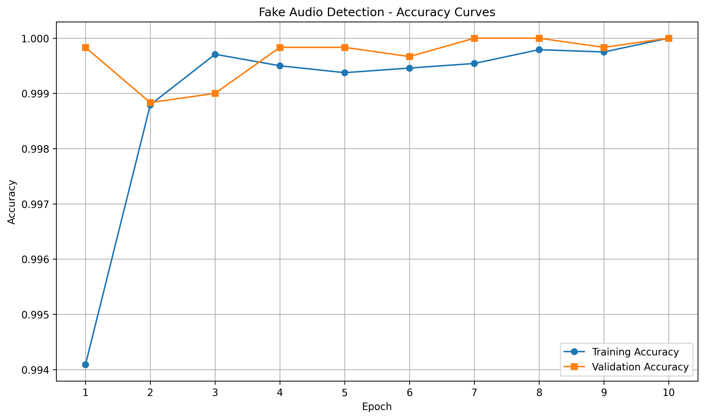
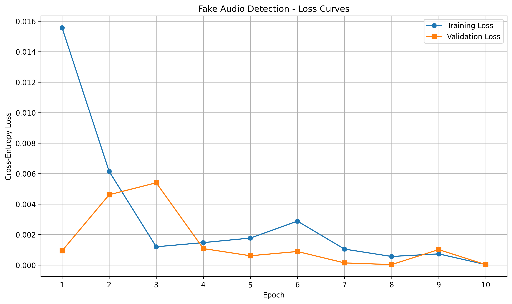

# VCFAD — Voice Cloning and Fake Audio Detection

A research and portfolio project exploring **voice cloning, speaker identity, and synthetic-audio detection** using deep learning and speech-processing tools.

The project has two main components:

1. **Voice Cloning and Speaker Analysis** — generate speech conditioned on a target speaker and evaluate how closely the generated audio resembles that speaker.
2. **Fake Audio Detection** — train and evaluate a deep-learning model that distinguishes real speech from synthetic audio.

> **Responsible use:** This project is intended for research and educational purposes. Use voice-cloning systems only with appropriate consent and in accordance with applicable laws, platform policies, and dataset and model licenses.

## Table of Contents

- [Project Overview](#project-overview)
- [Repository Structure](#repository-structure)
- [Technologies](#technologies)
- [Datasets](#datasets)
- [Setup and Installation](#setup-and-installation)
- [Workflow](#workflow)
- [Results and Evaluation](#results-and-evaluation)
  - [Fake Audio Detection Accuracy](#1-fake-audio-detection--accuracy)
  - [Fake Audio Detection Loss](#2-fake-audio-detection--loss)
  - [Voice Cloning Word Error Rate](#3-voice-cloning--word-error-rate-wer)
  - [Speaker Classification](#4-speaker-classification)
- [Limitations and Future Work](#limitations-and-future-work)
- [Responsible Use](#responsible-use)
- [License](#license)

## Project Overview

### Voice Cloning and Speaker Analysis

The voice-cloning workflow uses XTTS-v2 and speaker representations to generate speech conditioned on a reference voice. Generated audio can then be evaluated through automatic speech recognition, speaker-embedding similarity, and speaker classification.

The objective is to investigate both the intelligibility of generated speech and its similarity to the intended speaker.

### Fake Audio Detection

The fake-audio detection workflow prepares real and synthetic audio, extracts audio features, trains a deep-learning classifier, and evaluates its ability to distinguish real speech from generated speech.

Training and validation accuracy and loss plots are used to monitor learning progress and identify potential overfitting.

## Repository Structure

```text
VCFAD/
├── README.md
├── .gitignore
├── data/
│   └── evaluation/
│       └── speaker_confusion_matrix.csv
├── fake_audio_detector/
│   ├── dataset.ipynb
│   ├── dataset.py
│   ├── features.py
│   ├── model.ipynb
│   ├── model.py
│   ├── preprocessing.ipynb
│   ├── train.ipynb
│   └── evaluate.ipynb
├── models/
│   ├── accuracy_curve.png
│   └── loss_curve.png
└── voice_cloning/
    ├── EDA.ipynb
    ├── preprocessing.ipynb
    ├── generate.ipynb
    ├── generate_manifest.ipynb
    ├── speaker_encoder.py
    ├── speaker_classification.ipynb
    ├── train.ipynb
    └── evaluate.ipynb
```

*This tree represents the principal project files. Adjust the listing if your current branch uses different filenames.*

## Technologies

- **Python** — data preparation, experimentation, and evaluation
- **PyTorch** — deep-learning models
- **XTTS-v2** — voice cloning and speech generation
- **WavLM** — speech representations and audio features
- **Whisper** — automatic speech recognition and transcription
- **NumPy and pandas** — data processing and analysis
- **scikit-learn** — evaluation metrics and confusion matrices
- **Jupyter Notebook** — experimentation and visualization

Dependencies may vary by notebook, model version, and operating system.

## Datasets

### TIMIT

TIMIT is used in the voice and speaker-analysis workflow. It contains speech recordings organized by speaker and dataset partition.

Obtain the dataset from an authorized source and follow its licensing and usage requirements.

### Common Voice

Common Voice provides speech recordings that can support experiments involving real speech and synthetic-audio detection.

Download an authorized dataset release and follow its applicable terms.

**Dataset files, generated audio, and large model checkpoints are not included in this repository.** Configure the paths for your own environment. Avoid committing private audio, credentials, large binary files, or machine-specific absolute paths.

## Setup and Installation

### 1. Clone the repository

```bash
git clone https://github.com/bqsauce-ux/0SN6xZ1UAq9Lxurt.git
cd 0SN6xZ1UAq9Lxurt
git checkout clean-main
```

If your repository uses a different branch, check out the appropriate branch instead.

### 2. Create a virtual environment

**macOS / Linux**

```bash
python3 -m venv .venv
source .venv/bin/activate
python -m pip install --upgrade pip
```

**Windows PowerShell**

```powershell
py -m venv .venv
.venv\Scripts\Activate.ps1
python -m pip install --upgrade pip
```

### 3. Install dependencies

If the repository contains a `requirements.txt` file:

```bash
pip install -r requirements.txt
```

Otherwise, install the dependencies required by the notebook or script you intend to run.

Audio and machine-learning packages can have platform-specific requirements. Follow the relevant installation instructions for PyTorch, XTTS-v2, WavLM, Whisper, and the audio-processing libraries used in your workflow.

### 4. Configure dataset and model paths

Update notebook configuration or script arguments to point to your local dataset and model locations.

For example, the TIMIT directory may be organized into `train` and `test` folders with additional speaker directories. Ensure your preprocessing code reflects your actual directory structure.

Do not commit credentials, private recordings, or machine-specific absolute paths.

### 5. Launch Jupyter

From the repository root:

```bash
jupyter lab
```

Run the notebooks in the appropriate order, starting with data exploration and preprocessing, followed by training or generation, and finally evaluation.

## Workflow

### Voice Cloning and Speaker Analysis

1. Prepare reference audio and evaluation data.
2. Extract speaker representations using the configured speaker encoder.
3. Generate speech with the configured voice-cloning model.
4. Transcribe generated speech using Whisper.
5. Compare the transcription against the reference transcript using WER.
6. Evaluate speaker similarity or speaker classification performance.

### Fake Audio Detection

1. Prepare real and synthetic audio samples.
2. Extract and preprocess audio features.
3. Train the fake-audio detection model.
4. Track training and validation accuracy and loss.
5. Evaluate model performance on held-out data.
6. Inspect the confusion matrix and other classification metrics.

## Results and Evaluation

This section presents the project's saved training plots and describes the evaluation methods used in the voice-cloning and fake-audio detection workflows.

### 1. Fake Audio Detection — Accuracy



The accuracy curve displays training and validation accuracy across epochs.

Comparing the two curves helps assess whether the model is learning useful patterns and whether its performance on validation data follows its training performance.

**How to interpret the plot:**

- Increasing accuracy suggests the model is learning to classify the training examples.
- Improving validation accuracy suggests better performance on the validation split.
- A substantial gap between training and validation accuracy may indicate overfitting.
- High accuracy alone does not establish that the model will generalize to unfamiliar datasets or voice-generation systems.

The saved plot is included in the repository at `models/accuracy_curve.png`.

### 2. Fake Audio Detection — Loss



The loss curve displays training and validation loss across epochs.

Loss measures how far the model's predictions are from the target labels according to its training objective.

**How to interpret the plot:**

- Decreasing training loss generally indicates that the model is fitting the training data.
- Decreasing validation loss can indicate improving performance on held-out validation examples.
- Training loss that continues to decrease while validation loss increases can be a sign of overfitting.
- A stable loss curve may indicate convergence, although the appropriate stopping point depends on validation performance and the evaluation objective.

The saved plot is included in the repository at `models/loss_curve.png`.

These curves should be interpreted alongside held-out test results, class balance, and the data-splitting procedure. Performance may change with a different random seed, dataset partition, preprocessing configuration, or model checkpoint.

### 3. Voice Cloning — Word Error Rate (WER)

**Word Error Rate (WER)** measures the difference between a reference transcript and the transcription produced from generated speech.

It is commonly calculated as:

\[
\mathrm{WER} = \frac{S + D + I}{N}
\]

Where:

- **S** = number of substitutions
- **D** = number of deletions
- **I** = number of insertions
- **N** = number of words in the reference transcript

A lower WER indicates closer word-level agreement between the generated speech's transcription and the reference text.

#### How WER is used in this project

1. Generate speech using the voice-cloning workflow.
2. Transcribe the generated audio using Whisper.
3. Compare the resulting transcription with the reference transcript.
4. Calculate WER for the evaluated recordings.
5. Summarize the results across the evaluation set.

WER is a measure of **transcription accuracy**, not speaker identity or audio authenticity. A generated clip may have a low WER while still sounding unlike the intended speaker. Conversely, speech can sound similar to the target speaker but contain transcription errors.

#### WER results

The voice-cloning evaluation workflow can export results to:

`data/evaluation/vc_wer_results.csv`

Use the actual evaluation output to populate the following table.

| Evaluation item | Result |
|---|---|
| Number of clips evaluated | Report measured count |
| Speech recognition model | Whisper model/version used |
| Reference data | Reference transcripts paired with evaluated clips |
| Aggregation method | Mean per-clip WER or corpus-level WER |
| WER | Insert verified result |

**Important:** No numeric WER result is claimed here because it should be taken from the actual evaluation output. Do not substitute an example value for a measured result.

Before publishing the CSV, check that it does not contain private transcript content, sensitive audio metadata, or machine-specific absolute paths.

#### Mean per-clip WER versus corpus-level WER

These aggregation methods are not necessarily equivalent:

- **Mean per-clip WER:** calculate WER for each clip and average the individual scores.
- **Corpus-level WER:** sum substitutions, deletions, and insertions across the corpus, then divide by the total number of reference words.

State which method is used so readers can interpret and reproduce the reported result.

### 4. Speaker Classification

Speaker classification evaluates whether an audio sample is assigned to the correct speaker identity.

The repository includes a confusion-matrix file:

`data/evaluation/speaker_confusion_matrix.csv`

A confusion matrix compares true speaker labels with predicted labels:

- **Diagonal values** represent correct classifications.
- **Off-diagonal values** represent cases where the model predicted a different speaker.

Speaker classification complements WER and speaker-embedding similarity. These metrics measure different aspects of generated audio and should not be treated as interchangeable.

For a complete evaluation, consider reporting the number of speakers, the number of evaluated recordings, overall accuracy, per-speaker performance, and the dataset split used.

## Limitations and Future Work

- **Dataset coverage:** Results depend on the speakers, languages, recording conditions, and synthetic-audio sources represented in the data.
- **Generalization:** A detector evaluated on one dataset may not perform equally well on unseen voice generators, codecs, accents, or recording environments.
- **WER limitations:** WER measures transcript agreement, not speaker identity or whether a recording is genuine.
- **Speaker similarity:** Embedding-based similarity can be affected by noise, clip duration, language, and recording conditions.
- **Class imbalance:** Uneven numbers of real and synthetic examples can make accuracy alone misleading.
- **Reproducibility:** Results depend on dataset splits, preprocessing, model versions, and random seeds.

Potential next steps include evaluating on unseen speakers and generation systems, reporting precision, recall, F1-score, and ROC-AUC where appropriate, and documenting model checkpoints and reproducible data splits.

## Responsible Use

Voice cloning and synthetic speech can be misused for impersonation, fraud, or misleading recordings.

Use authorized datasets and voices, obtain consent where required, disclose synthetic content when appropriate, and avoid using this project to deceive or harm others.

## License

Check the repository for a `LICENSE` file before reusing the code. If no license is provided, do not assume the repository grants permission for reuse.

Dataset and pretrained-model licenses are separate from the code license and must also be followed.
